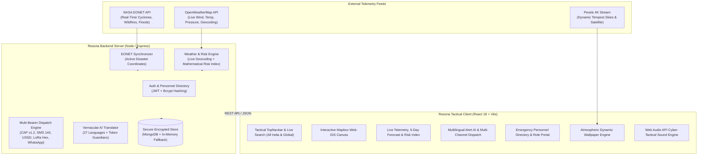

# 🛰️ Resona - Last-Mile Emergency Broadcast & Disaster Intelligence Platform

[](https://reactjs.org/)
[](https://vitejs.dev/)
[](https://tailwindcss.com/)
[](https://nodejs.org/)
[](https://expressjs.com/)
[](https://www.mongodb.com/)
[](https://www.mapbox.com/)
[](https://eonet.gsfc.nasa.gov/)
[](https://openweathermap.org/)
[](https://opensource.org/licenses/MIT)

> **Resona** is a mission-critical, multi-bearer disaster intelligence and last-mile emergency broadcast platform. It bridges the fatal communication gap during catastrophic weather and climate disasters (cyclones, floods, severe storms, heatwaves) by combining real-time NASA & OpenWeather telemetry, AI-powered vernacular translation across **27 languages**, dynamic geocoding across **all Indian and global locations**, and fail-safe dissemination across cellular, WhatsApp, SMS, USSD, and off-grid LoRa mesh radio networks.

---

## 📌 The Problem & Resona's Solution

During severe climate emergencies:
1. **Network Blackouts:** Traditional 4G/5G cell towers and internet backbones fail due to extreme winds, flooding, or grid power collapses.
2. **Language Barriers:** Official bureaucratic bulletins from meteorological agencies are issued in complex English or formal Hindi, leaving coastal fishers, rural farmers, and linguistic minorities unaware of urgent life-saving steps.
3. **Geographic Coverage Limits:** Many alert systems only monitor select state capitals or coastlines, leaving thousands of inland districts and rural taluks unindexed.
4. **Information Overload & Spoofing:** First responders need real-time geospatial positioning of active hazards, localized risk scoring, and verified responder identity authorization to prevent panic and disinformation.

### How Resona Solves This:
- **Comprehensive Geospatial Coverage:** Complete coverage across **180+ pre-indexed Indian cities and districts** across all 28 states and union territories, coupled with live backend geocoding (`/api/weather/search`) for any global location.
- **Vernacular AI with Token Shields:** Translates official warnings into **27 languages** (all 22 Eighth Schedule languages of India plus global vernaculars) while strictly protecting critical numbers, wind velocities, dates, wave heights, and emergency helpline numbers with regex-based token guardians (`__PROTECT0__`).
- **Multi-Bearer Emergency Dissemination:** Dispatches alerts across Common Alerting Protocol (OASIS CAP XML 1.2), compact 140-char SMS, offline USSD dial strings (`*999*...#`), raw hexadecimal LoRa packets for off-grid 868MHz radio modems, and instant **WhatsApp Direct** dispatch.
- **Live NASA & Sensor Web-GIS:** Visualizes satellite-tracked disaster events from NASA EONET v3 and live atmospheric measurements from OpenWeather onto an interactive dark Web-GIS canvas.
- **Secure Emergency Personnel Directory & RBAC:** Enforces strict role verification (Disaster Commanders, IMD Meteorologists, Authorized Relief Volunteers, and Citizen SOS reporters) backed by bcrypt password hashing and fail-safe storage.

---

## 🏗️ System Architecture



---

## ⚡ Key Platform Capabilities

### 1. 🇮🇳 All-India & Global Geographic Search Engine
- **180+ Pre-Indexed Indian Cities & Disaster Zones:** Instant one-click selection across all 28 states and 8 union territories (Odisha coastal belt, Gujarat cyclonic corridor, Bay of Bengal delta, Western Ghats, Himalayan flash flood valleys, etc.).
- **Live Backend Geocoding:** Type any district, town, or village in India or anywhere worldwide (`/api/weather/search?q=...`) to instantly stream real-time weather sensors, atmospheric pressure, wind vectors, and local vernacular advisories.
- **GPS Reverse Geocoding:** Instant coordinates-to-location mapping (`/api/weather/reverse?lat=...&lon=...`) for automated responder positioning.

### 2. 🌐 Vernacular AI Translation (27 Regional & Global Languages)
- Instant translation of bureaucratic disaster advisories into clean, high-urgency colloquial warnings:
  - **All 22 Official Eighth Schedule Indian Languages:** Assamese, Bengali, Bodo, Dogri, Gujarati, Hindi, Kannada, Kashmiri, Konkani, Maithili, Malayalam, Manipuri, Marathi, Nepali, Odia, Punjabi, Sanskrit, Santali, Sindhi, Tamil, Telugu, Urdu.
  - **Additional Regional & Global Dialects:** Bhojpuri, Marwari, Chhattisgarhi, English, and international tongues.
- **Critical Token Guardian:** Regex shields critical numbers, dates, wind speeds (e.g., `135 km/h`), wave heights (`6.5m`), and helpline codes (`1077`, `112`) so AI translation models never distort numerical facts.
- **Native Voice Synthesizer:** Real-time text-to-speech audio broadcast using native regional accents via the Web Speech API.

### 3. 📡 Multi-Bearer Resilient Dispatch & Actionable Channels
Dispatches simultaneously across five resilient communication bearers:
- **WhatsApp Direct Dispatch:** Generates one-tap pre-filled emergency links for rapid broadcast to community WhatsApp groups and responder circles.
- **Device SMS Launcher:** Pre-composes localized SMS alerts ready for single-tap cellular dispatch to field personnel.
- **OASIS Common Alerting Protocol (CAP v1.2 XML):** Standardized machine-readable XML for automated integration with emergency sirens, TV tickers, and civil defense nodes.
- **Compressed SMS 140:** Ultra-compact plain-text alerts engineered to fit inside a single 140-character GSM SMS packet.
- **Offline USSD Protocol Strings:** Rapid dial codes (`*999*01*...#`) accessible on 2G feature phones without an active data plan.
- **LoRa Mesh Hexadecimal Payloads:** Ultra-compact hexadecimal byte strings formatted for long-range, low-power 868MHz / 433MHz emergency radio repeaters.

### 4. 🗺️ Geospatial Disaster Command Center (Mapbox Web-GIS)
- Real-time plotting of active global and national disaster coordinates fetched from **NASA EONET v3**.
- Color-coded severity pins:
  - 🔴 **Severe / Critical Hazards** (Super Cyclones, Active Wildfires, Flash Floods)
  - 🟡 **Moderate / Caution Zones** (Severe Thunderstorms, High Winds, Heavy Rains)
  - 🔵 **Primary Meteorological Hubs** (Puri, Paradip, Kolkata, Chennai, Mumbai, Bhubaneswar, etc.)
- Interactive popup overlays providing categorized emergency instructions, coordinates, and real-time wind/temperature telemetry.

### 5. 🧮 Mathematical Real-Time Risk Index
- Computes risk levels (`Low`, `Moderate`, `High`, `Very High`) dynamically from live atmospheric observations:
  $$\text{Risk Score} = \text{base} + (\text{Wind} \times 0.45) + (\text{Precipitation} \times 0.35) + (\text{Thermal/Convective} \times 0.20)$$
- Real-time tactical gauge visualization with dynamic color shifting and animated status indicators.

### 6. 🛡️ Emergency Personnel Directory & Role-Based Access Control (RBAC)
- Full authentication system with JWT sessions and bcrypt password hashing.
- Four distinct operational tiers:
  1. **Disaster Management Officer / Commander:** Full administrative command, state-wide broadcasts, emergency drill controls.
  2. **Meteorological Specialist (IMD):** Scientific weather verification, radar telemetry validation, sensor calibration.
  3. **Disaster Relief Volunteer:** Verified on-ground field responders authorized to broadcast local neighborhood alerts.
  4. **Citizen / Resident:** Access to vernacular advisories, personal safety check-in, and one-touch SOS dispatch.
- Clean, production-hardened interface that displays verified responder rosters without exposing internal database connection URIs.

### 7. 🎨 Dynamic Atmospheric Ambience & Cyber-Tactical Audio
- **Pexels 4K Stream:** Dynamic curated wallpapers of cyclones, storm fronts, and tempest skies with manual pickers and auto-refresh timers.
- **Web Audio API Sound Engine:** Zero external audio assets; synthesizes tactical interface blips, critical alert sirens, broadcast success chimes, and verification dings using browser oscillators.

---

## 📂 Repository Structure

```
IGNITHON-WEATHER/
├── Resona/
│   ├── BACKEND/                        # Express API & Disaster Telemetry Engine
│   │   ├── models/                     # Mongoose schemas (User, Alert, Telemetry, etc.)
│   │   ├── routes/
│   │   │   ├── authRoutes.js           # RBAC & Personnel Directory routes
│   │   │   ├── alertRoutes.js          # Broadcast, CAP generation & EONET routes
│   │   │   └── weatherRoutes.js        # Live sensors, geocoding & hazard alerts
│   │   ├── services/                   # Business logic (eonetService, capGenerator, translatorService)
│   │   ├── data/                       # Pre-configured disaster scenarios & presets
│   │   ├── server.js                   # Main API entry point
│   │   ├── .env.example                # Backend environment template (safe)
│   │   └── package.json
│   │
│   ├── FRONTEND/                       # React 18 + Vite Tactical Web-GIS Client
│   │   ├── public/                     # Satellite backgrounds & static assets
│   │   ├── src/
│   │   │   ├── components/             # UI Components (IndiaDisasterMap, TopNavbar, AuthPage, etc.)
│   │   │   │   ├── MultilingualAlertAI.jsx # 27-Language Vernacular Dispatch Hub
│   │   │   │   ├── TopNavbar.jsx       # 180+ Location Autocomplete Search Engine
│   │   │   │   ├── AuthPage.jsx        # Emergency Personnel Directory & RBAC Portal
│   │   │   │   ├── AuthModal.jsx       # Quick Authentication & Responder Modal
│   │   │   │   └── IndiaDisasterMap.jsx# Mapbox Web-GIS Canvas
│   │   │   ├── context/                # React context (AuthContext, WeatherContext)
│   │   │   ├── services/               # Client-side services (pexelsService)
│   │   │   ├── utils/                  # Tactical audio synthesizer & helper scripts
│   │   │   ├── App.jsx                 # Master application controller & navigation
│   │   │   ├── index.css               # Tailwind design system & tactical keyframe animations
│   │   │   └── main.jsx
│   │   ├── .env.example                # Frontend environment template (safe)
│   │   ├── vite.config.js
│   │   └── package.json
│   │
│   ├── multilingual-alert-ai/          # Python/FastAPI Neural Translation Microservice
│   │   ├── app/                        # FastAPI application, token shields & model loaders
│   │   ├── tests/                      # Unit tests for translation & token preservation
│   │   ├── Dockerfile
│   │   └── requirements.txt
│   │
│   ├── .gitignore                      # Security-hardened git ignore rules
│   └── README.md                       # Comprehensive documentation
│
└── .gitignore                          # Root safety gitignore
```

---

## 🔌 API Endpoints Reference

### 1. Authentication & Personnel Directory (`/api/auth`)
| Method | Endpoint | Description |
|---|---|---|
| `POST` | `/api/auth/register` | Register a new responder profile with specific role and location |
| `POST` | `/api/auth/login` | Authenticate credentials; returns JWT session token |
| `GET` | `/api/auth/me` | Retrieve currently authenticated user profile |
| `GET` | `/api/auth/users` | List registered emergency responders and community members |
| `POST` | `/api/auth/seed-demo` | Seed default operational demonstration accounts if database is fresh |

### 2. Alerts & Emergency Broadcast (`/api`)
| Method | Endpoint | Description |
|---|---|---|
| `GET` | `/api/health` | System healthcheck and cloud sync status |
| `GET` | `/api/presets` | Pre-calibrated emergency scenarios (Cyclone, Heatwave, Tsunami) |
| `POST` | `/api/broadcast` | Dispatch emergency alert across CAP, SMS, USSD, LoRa & WhatsApp |
| `GET` | `/api/broadcast/logs` | Fetch historical broadcast transmission receipts |
| `GET` | `/api/telemetry` | Retrieve broadcast transmission delivery metrics |
| `GET` | `/api/nasa-eonet` | Real-time active disaster coordinates from NASA EONET v3 |
| `POST` | `/api/verify-alert` | Validate incoming text and protect critical tokens |
| `POST` | `/api/alerts/acknowledge` | Submit citizen safety check-in / SOS signal |
| `GET` | `/api/alerts/acknowledgements` | Fetch recent citizen check-in and SOS logs |

### 3. Weather Sensors & Geocoding (`/api/weather`)
| Method | Endpoint | Description |
|---|---|---|
| `GET` | `/api/weather/search?q=Bengaluru` | Geocoding search across any Indian city, district, or global location |
| `GET` | `/api/weather/reverse?lat=...&lon=...` | Reverse-geocodes GPS coordinates into city, state & country |
| `GET` | `/api/weather/current?city=Puri` | Live ambient weather observation and physical sensor metrics |
| `GET` | `/api/weather/batch` | Synchronized weather readings for major Indian disaster risk hubs |
| `GET` | `/api/weather/forecast?city=Puri` | 5-day atmospheric forecast breakdown |
| `GET` | `/api/weather/hazard-alerts` | Dynamic weather hazard alerts generated from physical sensors |

---

## 👥 Default Demo Personnel Accounts

Use these pre-configured accounts to test role-based permissions:

| Role | Name | Email | Password | Badge ID | Permissions |
|---|---|---|---|---|---|
| **Disaster Commander** | Commander Arjun Patel | `commander@resona.gov.in` | `Password123!` | `CMD-1011` | State-wide broadcasts, emergency drills, full control |
| **Meteorological Specialist** | Dr. Priya Sengupta | `priya.imd@gov.in` | `Password123!` | `MET-2022` | Sensor calibration, radar telemetry, risk scoring |
| **Disaster Relief Volunteer** | Ramesh Das | `ramesh.volunteer@gmail.com` | `Password123!` | `VOL-4022` | Localized vernacular alert dispatch |
| **Citizen / Resident** | Sunita Nayak | `citizen@resona.org` | `Password123!` | `CIT-8821` | Safety check-in, SOS signal, vernacular advisories |

---

## 🚀 Getting Started

### Prerequisites
- **Node.js** (v18.0 or newer)
- **npm** (v9.0 or newer)
- **MongoDB** (Optional: local instance on `mongodb://localhost:27017` or Atlas URI; *automatic in-memory fallback engages if MongoDB is unavailable*).

---

### Step 1: Environment Setup

#### Backend Configuration
Navigate to `Resona/BACKEND`:
```bash
cd Resona/BACKEND
cp .env.example .env
```
Configure `BACKEND/.env` with your values:
```env
PORT=5000
MONGODB_URI=mongodb://localhost:27017/resona_db
JWT_SECRET=your_super_secret_jwt_key
OPENWEATHER_API_KEY=your_openweather_api_key_here
```

#### Frontend Configuration
Navigate to `Resona/FRONTEND`:
```bash
cd ../FRONTEND
cp .env.example .env
```
Configure `FRONTEND/.env` with your keys:
```env
VITE_MAPBOX_TOKEN=your_mapbox_public_token_here
VITE_PEXELS_API=your_pexels_api_key_here
```
*(If no external API keys are supplied, the application automatically engages high-resolution offline storm visuals and resilient fallback telemetry).*

---

### Step 2: Install Dependencies & Run

#### Terminal 1 — Start Backend Server
```bash
cd Resona/BACKEND
npm install
npm start
```
The backend initializes on **`http://localhost:5000`** with automatic database seeding and healthcheck logging.

#### Terminal 2 — Start Frontend Client
```bash
cd Resona/FRONTEND
npm install
npm run dev
```
The interactive tactical command center will open on **`http://localhost:5173`**.

---

## 🔒 Security & Privacy

- **Protected Secrets:** No production secrets or personal API keys are tracked in version control. All credentials reside inside local `.env` files strictly ignored by git.
- **Production UI Hardening:** No internal database connection strings, credentials, or internal driver ports are exposed in the user interface.
- **Password Security:** All user credentials stored in the personnel directory are salted and hashed using **bcrypt** with a cost factor of 10.
- **Fail-Safe Graceful Degradation:** External API outages (NASA, OpenWeather, or Pexels) never disrupt system availability; built-in local cache pools and fallback presets seamlessly engage.

---

## 📄 License
This project is licensed under the **MIT License**. See the `LICENSE` file for details.
